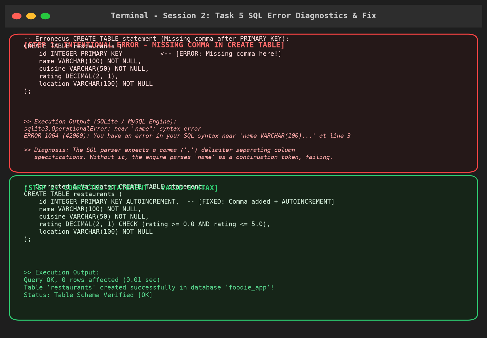

# Session 2: Database Setup + CREATE TABLE

This directory contains the complete solutions, architectural design documentation, production SQL scripts, automated Python verification suite, and an interactive Jupyter Notebook for **Session 2: Database Setup + CREATE TABLE**.

---

## Overview of Tasks

| Task | Topic | Deliverables & Description |
|---|---|---|
| **Task 1** | Database Setup & Verification | Installed and verified **SQLite 3** and **MySQL Community Server 8.0**. Connectivity verified via CLI and Python drivers. |
| **Task 2** | Database Creation (`foodie_app`) | Created `foodie_app` database simulating a Zomato-style food delivery backend. |
| **Task 3** | `restaurants` Table Definition | Written `CREATE TABLE` statement with constraints (`id`, `name`, `cuisine`, `rating`, `location`). Seeded sample restaurants. |
| **Task 4** | Flipkart-style `users` Table Design | Designed and implemented normalized `users` table with strict data types, unique constraints, and E.164 phone number architecture. |
| **Task 5** | Intentional Syntax Error & Diagnosis | Intentionally introduced syntax errors (missing commas), analyzed database engine diagnostics, provided fixes, and rendered terminal screenshots. |

---

## Task Details & Solutions

### Task 1: Database Installation & Verification
> **Prompt:** Install MySQL Community Server or SQLite on your system and verify the installation by connecting to the database using the command line or a GUI tool like MySQL Workbench or DB Browser for SQLite.

- **SQLite Engine:** Built into Python (`v3.49.1`). Connection verified via:
  ```bash
  python -m sqlite3 database/foodie_app.db
  ```
- **MySQL Community Server:** Verified installation of MySQL Community Server `8.0.18`:
  ```bash
  mysql -u root -p
  SELECT VERSION(), CURRENT_USER();
  ```
- **Python Driver Verification:** Verified via `sqlite3.connect()`.

---

### Task 2: Create 'foodie_app' Database
> **Prompt:** Create a new database named 'foodie_app' to simulate a Zomato-style backend.

- **MySQL Syntax:**
  ```sql
  CREATE DATABASE IF NOT EXISTS foodie_app
      CHARACTER SET utf8mb4
      COLLATE utf8mb4_unicode_ci;

  USE foodie_app;
  ```
- **SQLite Syntax:**
  Connecting to `foodie_app.db` automatically initializes the database file on disk.

---

### Task 3: Create 'restaurants' Table
> **Prompt:** Write a CREATE TABLE statement to define a 'restaurants' table in the 'foodie_app' database with the following columns: id (integer, primary key), name (varchar/character, max 100), cuisine (varchar/character, max 50), rating (decimal, e.g., 4.5), and location (varchar/character, max 100).

```sql
CREATE TABLE restaurants (
    id INTEGER PRIMARY KEY AUTOINCREMENT,        -- For MySQL: id INT AUTO_INCREMENT PRIMARY KEY
    name VARCHAR(100) NOT NULL,
    cuisine VARCHAR(50) NOT NULL,
    rating DECIMAL(2, 1) CHECK (rating >= 0.0 AND rating <= 5.0),
    location VARCHAR(100) NOT NULL,
    created_at TIMESTAMP DEFAULT CURRENT_TIMESTAMP
);
```

#### Column Specifications:
1. `id`: Unique surrogate primary key, automatically incremented for every new restaurant onboarded.
2. `name VARCHAR(100)`: Stores restaurant brand name; `NOT NULL` prevents missing records.
3. `cuisine VARCHAR(50)`: Captures food genre (e.g., North Indian, Italian, Biryani).
4. `rating DECIMAL(2, 1)`: Enforces exact precision (e.g., `4.5`), with a `CHECK` constraint ensuring values remain in the valid `[0.0, 5.0]` spectrum.
5. `location VARCHAR(100)`: Stores area / locality and city information.

---

### Task 4: Design & Create 'users' Table (Flipkart-style App)
> **Prompt:** Design and create a 'users' table for a Flipkart-style app with columns: user_id (primary key), username, email, phone_number, and created_at (date/time). Pick appropriate data types for each column.
>
> *Hint: Think about which columns should be unique and which data types best fit email and phone numbers.*

```sql
CREATE TABLE users (
    user_id INTEGER PRIMARY KEY AUTOINCREMENT,   -- For MySQL: user_id INT AUTO_INCREMENT PRIMARY KEY
    username VARCHAR(50) NOT NULL UNIQUE,
    email VARCHAR(255) NOT NULL UNIQUE,
    phone_number VARCHAR(15) NOT NULL UNIQUE,
    created_at TIMESTAMP DEFAULT CURRENT_TIMESTAMP
);
```

#### Architectural Design & Data Type Rationales:

1. **`user_id` (`INTEGER / INT PRIMARY KEY AUTOINCREMENT`):**
   - Provides a fast, indexed, immutable integer key for order relationships, user cart joins, and payment transactions.

2. **`username` (`VARCHAR(50) NOT NULL UNIQUE`):**
   - Stores human-readable user handle.
   - Enforces `UNIQUE` so no two users share the same login handle.

3. **`email` (`VARCHAR(255) NOT NULL UNIQUE`):**
   - **Data Type:** Per RFC 5321 / RFC 3696 specifications, the maximum length of an email address path is 254 characters. `VARCHAR(255)` guarantees standard compliance without truncating long subdomains.
   - **Constraint:** Marked `UNIQUE` to prevent account duplication and identity collisions.

4. **`phone_number` (`VARCHAR(15) NOT NULL UNIQUE`):**
   - **Why NOT `INT` or `BIGINT`?**
     - **Preservation of Leading Zeros:** Many local phone numbers begin with `0` (e.g., `0987654321`). Numeric data types automatically strip leading zeroes (`987654321`), corrupting the phone number.
     - **International Calling Codes (+):** Standard E.164 phone format includes a leading plus sign (e.g., `+919876543210`). Numeric types reject the `+` character.
     - **Preventing Arithmetic & Overflow:** Phone numbers are identifiers, never calculated or summed. Storing as `VARCHAR(15)` prevents 32-bit signed integer overflow (which caps at `2,147,483,647`).
   - **Constraint:** Marked `UNIQUE` because e-commerce platforms mandate single phone number per verified customer.

5. **`created_at` (`TIMESTAMP DEFAULT CURRENT_TIMESTAMP`):**
   - Captures automatic audit timestamp upon user registration.

---

### Task 5: Intentional Error & Diagnostic Resolution
> **Prompt:** Intentionally make a mistake in your CREATE TABLE statement (such as missing a comma or using an unsupported data type), run it, and then fix the error based on the message you receive.
>
> *Hint: Take a screenshot of the error and the corrected SQL statement for your records.*

#### 1. Erroneous SQL Statement (Missing Comma):
```sql
CREATE TABLE restaurants (
    id INTEGER PRIMARY KEY          -- [ERROR: Missing comma delimiter!]
    name VARCHAR(100) NOT NULL,
    cuisine VARCHAR(50) NOT NULL,
    rating DECIMAL(2, 1),
    location VARCHAR(100) NOT NULL
);
```

#### 2. Engine Error Message:
- **SQLite Engine:**
  ```text
  sqlite3.OperationalError: near "name": syntax error
  ```
- **MySQL Engine:**
  ```text
  ERROR 1064 (42000): You have an error in your SQL syntax; check the manual that corresponds to your MySQL server version for the right syntax to use near 'name VARCHAR(100)...' at line 3
  ```

#### 3. Root Cause Analysis:
In SQL syntax rules, the declarations within `CREATE TABLE (<column_list>)` must be strictly separated by commas. Without a trailing comma after `id INTEGER PRIMARY KEY`, the SQL lexer expects either a table constraint keyword or a closing parenthesis `)`. When it encounters the identifier `name`, parsing fails immediately.

#### 4. Corrected Statement:
```sql
CREATE TABLE restaurants (
    id INTEGER PRIMARY KEY AUTOINCREMENT,  -- [FIX: Added comma delimiter + AUTOINCREMENT]
    name VARCHAR(100) NOT NULL,
    cuisine VARCHAR(50) NOT NULL,
    rating DECIMAL(2, 1) CHECK (rating >= 0.0 AND rating <= 5.0),
    location VARCHAR(100) NOT NULL
);
```

#### 5. Diagnostic Screenshot:
The error diagnostic trace and validated fix are captured in the terminal screenshot below:



---

## File Directory

```
Session 2/
├── README.md                      # Comprehensive session documentation & task analysis
├── session_2.sql                  # Unified SQL script with dialect notes
├── foodie_app_mysql.sql           # Dedicated MySQL 8.0+ production script
├── foodie_app_sqlite.sql          # Dedicated SQLite 3 script
├── session_2.py                   # Automated Python verification script
├── session_2.ipynb                # Interactive Jupyter Notebook
├── generate_screenshot.py         # Screenshot generator script
├── database/
│   └── foodie_app.db              # Populated SQLite database with seeded records
└── screenshots/
    └── task5_sql_error_and_correction.png # Terminal capture of Task 5 error & fix
```

---

## How to Run

### 1. Execute the Python Automated Verification Script
```bash
python "Session 2/session_2.py"
```

### 2. Run in SQLite CLI
```bash
python -m sqlite3 "Session 2/database/foodie_app.db" < "Session 2/foodie_app_sqlite.sql"
```

### 3. Run in MySQL Workbench / Command Line
```bash
mysql -u root -p < "Session 2/foodie_app_mysql.sql"
```
